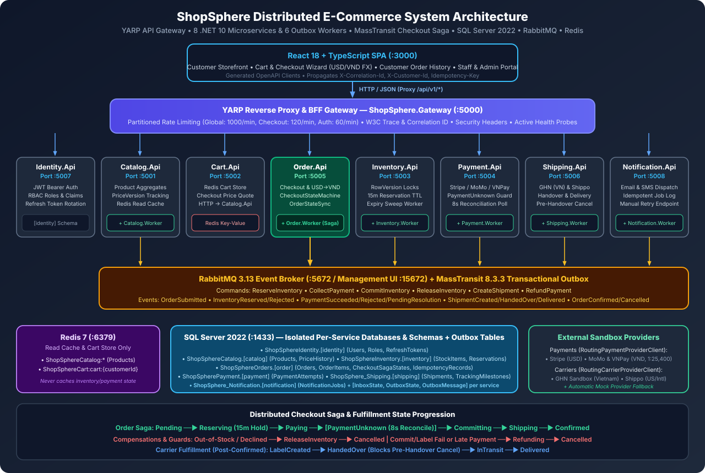
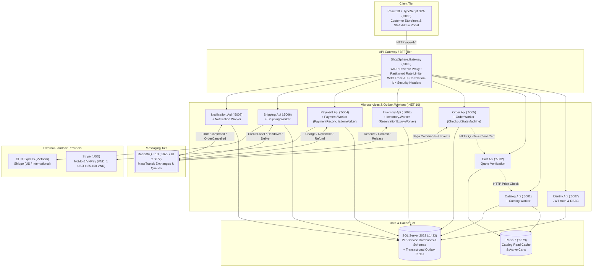
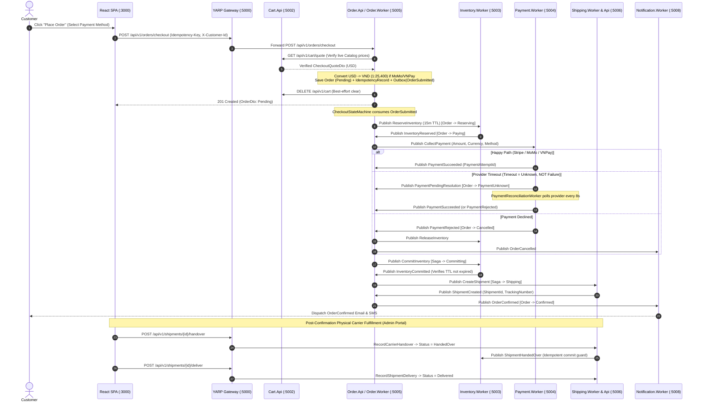
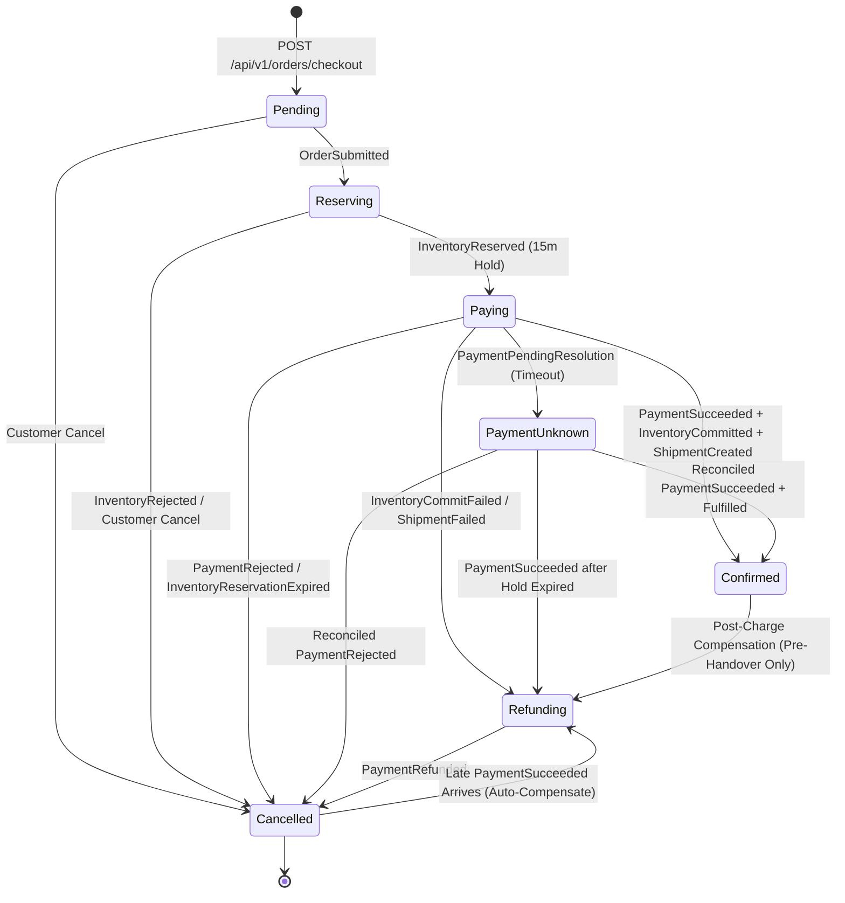
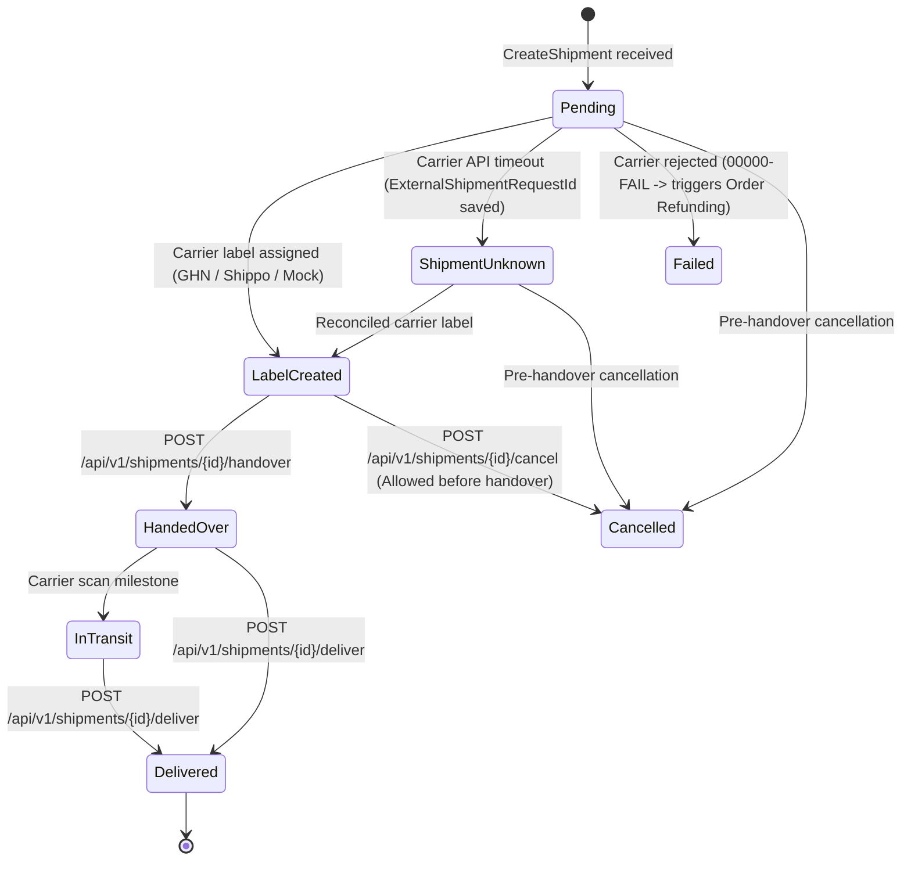

# ShopSphere System Architecture

This document provides the complete architectural reference for the **ShopSphere** distributed e-commerce platform, including service topology, the MassTransit Checkout Saga state machine, Transactional Outbox messaging flows, carrier fulfillment lifecycle, and database ownership boundaries.

---

## 1. High-Level System Topology

All browser traffic enters exclusively through the **YARP Reverse Proxy & BFF Gateway (`:5000`)**. Synchronous cross-service reads (such as `Cart.Api` verifying live prices from `Catalog.Api`, or `Order.Api` fetching the verified checkout quote from `Cart.Api`) occur over HTTP, while all multi-service checkout, inventory, payment, shipping, and notification workflows are coordinated asynchronously via **RabbitMQ** and **MassTransit Transactional Outbox** workers.

---

## 2. End-to-End Checkout Saga & Transactional Outbox Sequence

Every state transition writes business state and outgoing `MessageEnvelope<T>` records atomically in the same SQL transaction (`InboxState`, `OutboxState`, `OutboxMessage`), relayed asynchronously to RabbitMQ by each service's background worker.

---

## 3. Order Saga & Carrier Fulfillment State Machines

### 3.1 Order Aggregate & Saga State Machine (`Order.Domain` & `CheckoutStateMachine`)

### 3.2 Carrier Shipment State Machine (`Shipping.Domain`)

> **Physical Handover Guard**: Once a shipment reaches `HandedOver`, `InTransit`, or `Delivered`, `POST /api/v1/shipments/{id}/cancel` and order state transitions out of `Confirmed` are blocked with `409 Conflict` — physical goods require a customer return workflow rather than rolling back a database flag.

---

## 4. Service Boundaries & Database Ownership

Each microservice owns an isolated SQL Server database and schema with its own EF Core migration history and MassTransit Outbox tables (`InboxState`, `OutboxState`, `OutboxMessage`). Cross-database queries are strictly prohibited.

| Service | API Port | Worker Host | SQL Database & Schema | Primary Domain Tables | Cache / External Integration |
|---------|----------|-------------|-----------------------|-----------------------|------------------------------|
| **Gateway** | `:5000` | — | *(Stateless)* | — | YARP reverse proxy, rate limiting, W3C tracing |
| **Identity** | `:5007` | — | `ShopSphereIdentity` (`[identity]`) | `Users`, `Roles`, `Permissions`, `UserRoles`, `RolePermissions`, `RefreshTokens` | JWT Bearer issuance (`HS256`) |
| **Catalog** | `:5001` | `Catalog.Worker` | `ShopSphereCatalog` (`[catalog]`) | `Products`, `PriceHistory` | Redis read-through cache (`ShopSphereCatalog:*`) |
| **Cart** | `:5002` | — | *(Redis Only)* | — | Redis `ShopSphereCart:cart:{customerId}` + HTTP to `Catalog.Api` |
| **Inventory** | `:5003` | `Inventory.Worker` | `ShopSphereInventory` (`[inventory]`) | `StockItems` (`RowVersion`), `Reservations` (15m TTL) | `ReservationExpiryWorker` (sweeps expired holds) |
| **Payment** | `:5004` | `Payment.Worker` | `ShopSpherePayment` (`[payment]`) | `PaymentAttempts` (`RowVersion`), `IdempotencyRecords` | Stripe (`USD`), MoMo & VNPay (`VND`), `PaymentReconciliationWorker` |
| **Order** | `:5005` | `Order.Worker` | `ShopSphereOrders` (`[order]`) | `Orders`, `OrderItems`, `CheckoutSagaStates`, `IdempotencyRecords` | `CheckoutStateMachine`, `OrderStateSyncConsumer`, `USD -> VND` FX |
| **Shipping** | `:5006` | `Shipping.Worker` | `ShopSphere_Shipping` (`[shipping]`) | `Shipments` (`RowVersion`), `ShipmentItems`, `TrackingMilestones` | GHN Sandbox (`VN`), Shippo Sandbox (`US`/Intl), Mock fallback |
| **Notification** | `:5008` | `Notification.Worker` | `ShopSphere_Notification` (`[notification]`) | `NotificationJobs`, `IdempotencyRecords` | Email & SMS dispatchers with non-blocking retry |

---

## 5. Core Architectural Invariants

1. **Transactional Outbox Everywhere**: Business state changes and integration events are committed in the same SQL Server transaction (`AddEntityFrameworkOutbox`). Background workers (`UseBusOutbox`) publish to RabbitMQ after commit.
2. **Idempotency at Every Layer**:
   - **HTTP APIs**: `Idempotency-Key` + SHA-256 request payload fingerprinting (`IdempotencyRecords`); returns `409 Conflict` if the same key is reused with a different payload.
   - **Messaging Consumers**: MassTransit `InboxState` deduplicates by `MessageId`, plus domain guards (`PaymentAttempt`, `Reservation`, `Shipment`, `NotificationJob` unique constraints).
3. **Optimistic Concurrency (`rowversion`)**: Aggregate roots (`Order`, `StockItem`, `Reservation`, `PaymentAttempt`, `Shipment`, `Product`) use SQL Server `rowversion` tokens and handle `DbUpdateConcurrencyException` with bounded retries or explicit `409 Conflict` responses.
4. **Timeout = Unknown, Not Failure**: External payment or carrier timeouts transition to explicit protected states (`PaymentUnknown`, `ShipmentUnknown`) storing the provider operation reference (`PaymentAttemptId`, `ExternalShipmentRequestId`) so reconciliation workers query the provider before retrying or releasing stock.
5. **Late-Event Protection**: A late `PaymentSucceeded` arriving on an already `Cancelled` order never resurrects the order; `CheckoutStateMachine` and `OrderStateSyncConsumer` transition the order to `Refunding` and emit `RefundPayment` to return the customer's funds.
